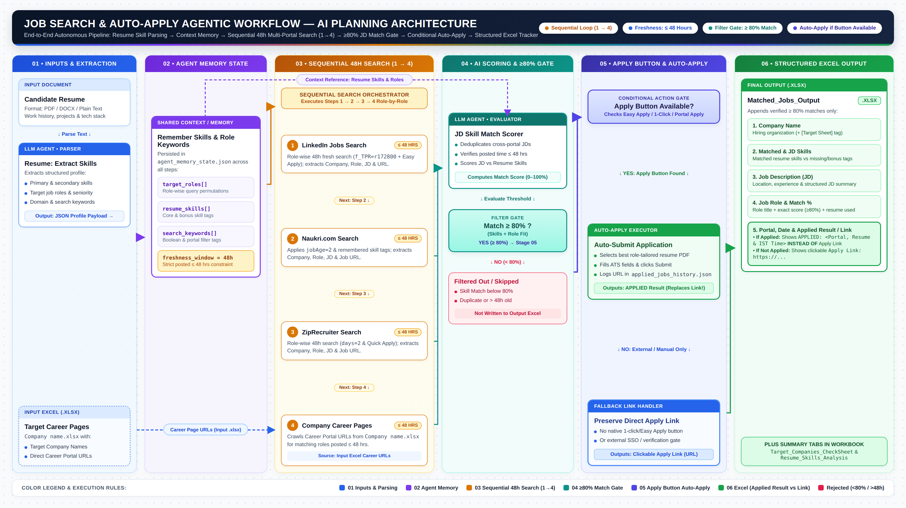

# AI Job Search & Auto-Apply Agent (6-Stage Agentic Workflow)



An autonomous **6-stage AI Job Search, Skill-Match & Conditional Auto-Apply Agent** targeting **LinkedIn**, **Naukri.com**, **ZipRecruiter**, and **Target Company Career Pages** (`Company name.xlsx`), plus **Exa**, **Firecrawl**, and **MCP** connectors.

## 6-Stage Agentic Workflow Architecture

1. **01 • Inputs & Extraction ([`uploaded_agent/agent_memory.py`](./uploaded_agent/agent_memory.py))**
   - Parses candidate resumes (`PDF` / `DOCX` / plain text) into a structured JSON profile payload (`primary_skills`, `secondary_skills`, `target_roles`, `search_keywords`).
   - Reads target company names and direct career portal URLs from [`uploaded_agent/Company name.xlsx`](./uploaded_agent/Company%20name.xlsx).
2. **02 • Agent Memory State (`agent_memory_state.json`)**
   - Persists `target_roles[]`, `resume_skills[]`, `search_keywords[]`, `career_pages[]`, `freshness_window = 48h`, and `match_threshold = 80%` across all pipeline steps.
3. **03 • Sequential 48h Search (`1 -> 2 -> 3 -> 4` Role-by-Role, [`uploaded_agent/scrapers.py`](./uploaded_agent/scrapers.py))**
   - **Step 1:** LinkedIn Jobs Search (`<= 48h`, `f_TPR=r172800`, standard + `Easy Apply`)
   - **Step 2:** Naukri.com Search (`<= 48h`, `jobAge=2` & skill tags)
   - **Step 3:** ZipRecruiter Search (`<= 48h`, `days=2` & `Quick Apply`)
   - **Step 4:** Company Career Pages (`<= 48h`, crawls direct career URLs from `Company name.xlsx`)
4. **04 • AI Scoring & `>= 80%` Gate ([`uploaded_agent/matcher.py`](./uploaded_agent/matcher.py))**
   - Deduplicates cross-portal JDs (preserving native-apply / richest JD entries), verifies `<= 48h` recency, and scores JD vs Resume Skills (`0–100%`).
   - Listings `< 80%` or `> 48h` are filtered out and **never written to Output Excel**.
5. **05 • Apply Button Gate & Conditional Auto-Apply ([`uploaded_agent/auto_applier.py`](./uploaded_agent/auto_applier.py))**
   - Selects the best role-tailored resume PDF (`ai_ml_engineer`, `power_bi_developer`, `data_engineer`, `mis_executive`, `business_analyst`, `data_analyst`).
   - Checks whether a native/direct **Apply** button (`Easy Apply`, `1-Click Apply`, `Quick Apply`, or accessible portal `Apply` + `Submit`) is available on the job posting:
     - **Available:** Automatically fills ATS fields, uploads the matched resume, submits the application, and logs the URL in `applied_jobs_history.json`.
     - **Not Available (or Verification/SSO Gate):** Safely stops without interacting with challenges and preserves the clickable **Direct Apply Link**.
6. **06 • Structured Excel Output ([`uploaded_agent/excel_reporter.py`](./uploaded_agent/excel_reporter.py) & [`job_agent/workflow.py`](./job_agent/workflow.py))**
   - Writes verified `>= 80%` matches to `Matched_Jobs_Output` inside `Applied_Companies_Tracker.xlsx` (and `output/Matched_Jobs_Output.xlsx`) with 5 columns:
     1. `Company Name`
     2. `Matched & JD Skills`
     3. `Job Description (JD)`
     4. `Job Role & Match %`
     5. `Portal, Posted Date & Applied Result / Apply Link` — **Displays `APPLIED: <Portal, Resume & IST Timestamp>` INSTEAD OF the apply link when auto-applied, or displays the clickable `Apply Link: https://...` when no direct Apply button was available.**
   - Includes summary sheets `Target_Companies_CheckSheet` and `Resume_Skills_Analysis`.

---

## Quick Start

### 1. Run the Restructured 6-Stage Workflow (CLI or Standalone)

```bash
pip install -r requirements.txt
python3 -m playwright install chromium

# Sign in once in a visible browser to persist portal sessions locally
python3 uploaded_agent/job_agent.py --setup-login

# Run full 6-stage workflow (Sequential 1->4 search, >=80% gate, Auto-Apply if button available, Excel output)
python3 -m job_agent workflow --max-apply 25

# Or run directly via uploaded_agent/job_agent.py
python3 uploaded_agent/job_agent.py --max-apply 25

# Search-only mode (skips auto-apply and writes clickable Apply Links for >=80% matches)
python3 -m job_agent workflow --search-only

# Retry auto-apply on unapplied link rows in Applied_Companies_Tracker.xlsx
python3 uploaded_agent/job_agent.py --continue --max-apply 25
```

### 2. Multi-Provider CLI, Exa, Firecrawl & MCP Server

```bash
# Public LinkedIn + API connectors (Exa & Firecrawl activate when keys are in .env)
python3 -m job_agent search --mode public --enrich-details

# Run built-in MCP JSON-RPC 2.0 stdio server
python3 -m job_agent mcp-serve
```

### 3. Autonomous Weekly Scheduler (Monday 11:00 AM IST Only)

- **Frequency:** Every Monday at **11:00 AM IST** (`Asia/Kolkata`, `05:30 UTC`).
- **Execution Model:** `Hydrogen - Medium Effort` (`hydrogen-medium`, `reasoning_effort: medium` in `profile.json`, `AGENT_MODEL`, and `.github/workflows/weekly_job_search.yml`).
- **Outputs:** `output/weekly_digest.md`, `output/weekly_digest.json`, and `output/Matched_Jobs_Output.xlsx`.

```bash
./setup_schedule.sh
python3 agent_runner.py --show-next-runs
python3 agent_runner.py --model hydrogen-medium --effort medium
```

## Running Tests

```bash
python3 -m unittest discover -s tests -v
```
